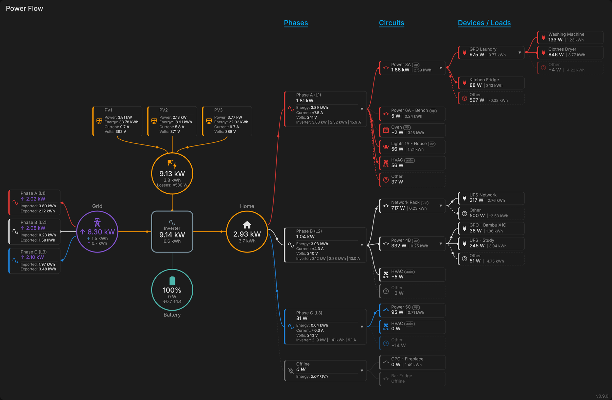
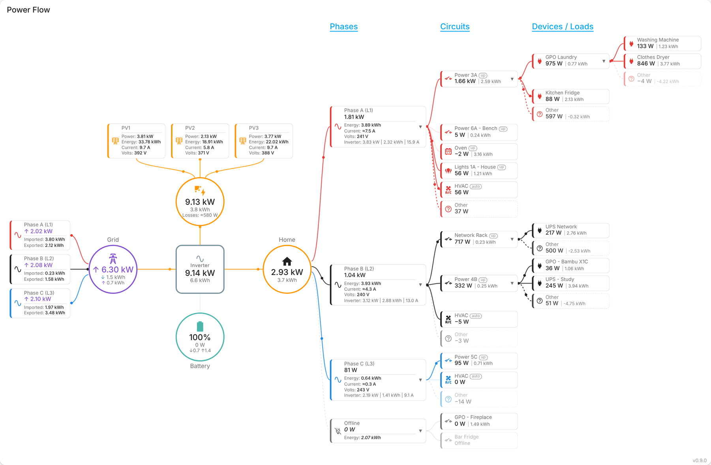

# Power Flow Phases Card

[](https://github.com/Roving-Ronin/Power-Flow-Phases-Card/releases)
[](https://github.com/Roving-Ronin/Power-Flow-Phases-Card/releases)
[](https://hacs.xyz)

[](https://github.com/Roving-Ronin/Power-Flow-Phases-Card/commits/main)
[](https://github.com/Roving-Ronin/Power-Flow-Phases-Card/actions/workflows/validate.yaml)
[](https://github.com/Roving-Ronin/Power-Flow-Phases-Card/actions/workflows/tests.yaml)
[](LICENSE)

A Home Assistant dashboard card that shows where your power goes, from the PV strings and the grid phases all the way down to the individual devices on each circuit.



It starts as a classic power-flow diagram (Solar, Grid, Battery, Home) and adds:

- **Hybrid inverter in the centre** (optional). Solar and battery connect on its DC side, home and grid on its AC side, so the lines follow the real path through a DC-coupled system. Shows AC output, today's energy, DC solar-to-battery charging and the system's own self use.
- **PV strings** above the Solar circle, each with power, energy, current and voltage. Unused strings hide themselves.
- **Grid phases** to the left of the Grid circle, with import/export power and today's imported/exported energy per phase.
- **House phases → circuits → devices** to the right of Home, in aligned columns, to any depth.
- **"Other" boxes** that show load a parent meter sees but none of its child meters account for, with ⚠ when the children add up to more than the parent (usually a wrong upstream or a doubled-up meter).
- **Builds itself from your Energy dashboard** (optional): grid/solar/battery power sensors, individual devices and their *upstream device* links.
- **Today's kWh from recorder statistics**, the same numbers as the Energy dashboard's Today view, so lifetime meters work without `utility_meter` helpers.
- Automatic phase detection from entity names, an Offline group for unavailable or idle devices, animated flow dots, fit-to-screen scaling, hover-to-zoom, and light/dark theme support.

Single JavaScript file, no dependencies.

> The example configuration is for a three-phase **Sigenergy** system, but the card works with any inverter, battery or meter that provides power sensors in Home Assistant, single or three phase.

## Install

### Home Assistant Marketplace / HACS

Until the card is in the default catalog, add it as a custom repository:

1. Open **Settings → Marketplace** (Home Assistant 2026.11 and later) or **HACS** (earlier versions).
2. Add `https://github.com/Roving-Ronin/Power-Flow-Phases-Card` as a custom repository, type **Dashboard** (in HACS: **⋮ → Custom repositories**).
3. Find **Power Flow Phases Card**, download it, and reload the browser when asked.

The dashboard resource is added automatically. If your dashboards are in YAML mode, add the resource the install dialog shows you.

### Manual

1. Download `power-flow-phases-card.js` from the [latest release](https://github.com/Roving-Ronin/Power-Flow-Phases-Card/releases/latest) into `/config/www/`.
2. **Settings → Dashboards → ⋮ → Resources → Add resource**: URL `/local/power-flow-phases-card.js`, type **JavaScript module**.
3. Reload the browser.

The card's version is shown in its bottom-right corner, and in the browser console as `POWER-FLOW-PHASES-CARD`. If it still shows the old version after an update, clear the browser cache.

## Quick start

Add a card, choose **Manual**, and start with the Energy dashboard doing most of the work:

```yaml
type: custom:power-flow-phases-card
title: Power Flow
energy_dashboard: true
```

That gives you the Solar / Grid / Battery / Home flow, plus every individual device from your Energy dashboard. Devices whose phase can't be worked out go under **Unknown**. Then add your phases, and optionally the inverter and PV strings:

```yaml
type: custom:power-flow-phases-card
title: Power Flow
energy_dashboard: true
entities:
  inverter:
    power: sensor.inverter_ac_power
phases:
  - name: Phase A (L1)
    grid: sensor.grid_phase_a_power
    load: sensor.house_phase_a_power
  - name: Phase B (L2)
    grid: sensor.grid_phase_b_power
    load: sensor.house_phase_b_power
  - name: Phase C (L3)
    grid: sensor.grid_phase_c_power
    load: sensor.house_phase_c_power
```

A complete real-world example is in [`examples/sigenergy-3-phase.yaml`](examples/sigenergy-3-phase.yaml), with the Home Assistant package that creates the per-phase house-load and grid import/export sensors in [`examples/sigen_phase_consumption.yaml`](examples/sigen_phase_consumption.yaml).



## Sign conventions (check these first)

Defaults follow Home Assistant's Energy dashboard convention:

| Sensor | Positive means | Flip with |
|---|---|---|
| `grid.power` | importing | `invert: true` |
| `battery.power` | discharging | `invert: true` |
| `phases[].grid.power` | importing on that phase | `invert: true` |
| phase / circuit / device power | consuming | `invert: true` on that node |

Some inverters report the battery the other way round (Sigenergy's `sigen_plant_battery_power` is + when charging), so set `battery.invert: true`. You can also give split sensors: `grid.power_import` + `grid.power_export`, or `battery.power_charge` + `battery.power_discharge`. Power sensors from the Energy dashboard already use Home Assistant's convention and need no `invert`.

Units are converted from each sensor's `unit_of_measurement`: W / kW / MW and Wh / kWh / MWh.

## How it works

### Core flow

Without an inverter, the flow between Solar, Battery, Grid and Home is worked out from their net power, the same way power-flow-card-plus does it: solar is assumed to supply the house first, then the battery, then the grid. That's a convention, not a measurement.

With `entities.inverter`, Solar → Inverter, Battery ↔ Inverter, Inverter → Home and Inverter ↔ Grid. Grid import also passes through the inverter to Home, as it does through a hybrid inverter's AC side. The inverter's AC lines take the colour of whatever mostly feeds them: solar, battery or grid. The Home ring shows the live supply mix.

The inverter shows:

- **AC output** and today's energy
- **DC→Batt**: solar charging the battery directly on the DC side, when it is
- **Self use: ≈x W**: PV + battery discharge + grid import − battery charge − grid export − house load. This is the inverter's and battery BMS's standby use plus conversion losses. It needs `entities.home.power`, and only shows when positive: in sunshine some inverters' own figures don't reconcile closely enough for it to mean anything.

### PV strings

```yaml
entities:
  solar:
    power: sensor.pv_power
    energy: sensor.pv_energy_today
    strings:
      count: 4
      power: sensor.inverter_pv{n}_power
      voltage: sensor.inverter_pv{n}_voltage
      current: sensor.inverter_pv{n}_current
      energy: sensor.inverter_pv{n}_daily_energy
      total: sensor.inverter_pv{n}_accumulated_energy   # lifetime, used only to hide unused strings
```

`{n}` is replaced by 1 to `count`. Strings can also be an explicit list of `{name, power, voltage, current, energy, total}`.

A string is hidden when its power sensor doesn't exist (for example, it's disabled), is unavailable, or its lifetime `total` is 0. It isn't hidden at 0 W, because every string reads 0 W at night.

With strings shown, the Solar circle adds **Losses: ≈x W**: the strings' total minus the solar power sensor, when positive. That's typically DC conversion losses, but it depends on how your inverter measures each figure, so treat it as an estimate.

### Phases, circuits and devices

Each phase has a **grid** side (left) and a **house** side (right):

| Box | Shows |
|---|---|
| Grid phase | power (↓ import / ↑ export), then **Imported** and **Exported** kWh today |
| House phase | power, then **Energy**, **Current ≈** (house load ÷ phase voltage), **Volts**, and **Inverter: W \| kWh \| A** when `inverter:` is set on the phase |
| Circuit / device | **W \| kWh** |

```yaml
phases:
  - name: Phase A (L1)
    grid:
      power: sensor.grid_phase_a_power
      energy_import: sensor.grid_phase_a_import_energy     # lifetime or daily; shown as today
      energy_export: sensor.grid_phase_a_export_energy
    load:
      power: sensor.house_phase_a_power
      energy: sensor.house_phase_a_energy
    inverter:                                              # optional info line
      power: sensor.inverter_phase_a_power
      energy: sensor.inverter_phase_a_energy_daily
      voltage: sensor.inverter_phase_a_voltage
      current: sensor.inverter_phase_a_current
```

Any `power` or `energy` can be a list, which is added together. For example, house load on a phase = inverter output on that phase + grid power on that phase:

```yaml
    load: [sensor.inverter_phase_a_power, sensor.grid_phase_a_power]
```

Circuits can be nested under a phase (`phases[].circuits`), or listed once at the top level, where each one's phase is worked out (below). Any circuit or device can have its own `loads:`, to any depth:

```yaml
circuits:
  - name: Power 3A
    power: sensor.circuit_power_3a_gpo_power      # phase A, detected from the name
    loads:
      - name: Laundry GPO
        power: sensor.laundry_gpo_power
        loads:
          - name: Washing Machine
            icon: mdi:washing-machine
            power: sensor.washing_machine_power
          - name: Clothes Dryer
            icon: mdi:tumble-dryer
            power: sensor.clothes_dryer_power
```

### Working out each circuit's phase

For top-level circuits, and for Energy dashboard devices with no upstream device:

1. **Manual:** `phase:` set to `A`/`B`/`C`, `L1`/`L2`/`L3`, `1`/`2`/`3`, or `unknown`.
2. **Detected** from the power sensor's entity ID, then the name, using the first pattern that matches:
   - `phase_a`, `phase_b`, `phase_c`, `l1`, `l2` or `l3` as a whole word: `sensor.circuit_phase_b_network_rack_power` → B
   - `power_<number><a|b|c>`, a circuit number plus phase letter: `circuit_power_3a_gpo_power` → A, "Power 2C - Study" → C
   - `power_<number><l1|l2|l3>` → A/B/C, and `power_<number><l0|lx|x>` → Unknown

   Parts can be joined by `_`, a space or `-`, and the match has to end at a word boundary. So `circuit_power_8cworkbench…` doesn't match (use `circuit_power_8c_workbench…`), and `power_3am_timer` is ignored. `detect_circuit_numbers: false` turns off the circuit-number patterns.
3. Otherwise **Unknown**: a grey group with a dashed line from Home. Its total isn't subtracted from any phase's "Other".

Each circuit has a small tag saying how its phase was decided: `auto`, `set`, `up` (from its Energy dashboard upstream device) or `?`. `show_phase_source: false` hides them.

**Offline:** a box whose power sensor is unavailable shows *Offline*. Top-level devices with no phase that are unavailable, or idle at ≤ `idle_threshold` W along with everything under them, are grouped under **Offline** instead of Unknown, and move back automatically when they draw power.

### "Other" (unmeasured) boxes

Wherever a box has its own power sensor and at least one child, an **Other** box shows **parent − sum of children**:

| Other | Shown as | Meaning |
|---|---|---|
| positive | normal, with flow | load on that phase/circuit that no meter below it covers |
| within ±`unmeasured_threshold` | dimmed, no flow | everything is metered |
| below −`unmeasured_threshold` | red dashed with ⚠ | the children add up to more than the parent |

A ⚠ usually means a device has the wrong upstream, a load is metered twice, or a meter reads high. Meters updating at slightly different moments also cause small, flickering differences, so `unmeasured_threshold` (default 20 W) keeps those quiet. Other kWh is shown when the parent and every child have energy sensors. `show_unmeasured: false` hides Other boxes.

### Using the Energy dashboard

With `energy_dashboard: true`, the card reads **Settings → Dashboards → Energy** when it loads:

| Energy dashboard setting | Used for |
|---|---|
| Grid / Solar / Battery power sensors | Core power, where YAML doesn't set it. Several sources of a type are added together |
| Battery state of charge | Battery SOC |
| Individual devices (energy, power, name) | Circuits and devices |
| Individual devices: **upstream device** | Nesting: a device sits under its upstream device, to any depth |

**Phase and whole-house devices are merged, not duplicated.** If a device measures the same thing as a phase or Home in YAML (the same power or energy sensor as the phase's `load:` or `entities.home`), it becomes that box instead of a circuit, and its children become the phase's circuits. If the sensors differ, name the device with `device: <entity>` on the phase or on `entities.home`.

**YAML always wins:**

- Any core sensor set in `entities:` is used instead of the Energy dashboard's.
- A device whose power or energy sensor is already used by a YAML circuit is skipped, with its children.
- `devices:` adjusts individual Energy dashboard devices, matched by their power or energy sensor:

```yaml
devices:
  - entity: sensor.circuit_oven_power
    phase: A
    icon: mdi:stove
  - entity: sensor.hvac_energy
    exclude: true
```

The settings are read when the dashboard loads, so reload the page after changing them. If they can't be read, the card shows a message and uses YAML only. `energy_dashboard_devices: false` uses the core sources but not the devices.

### Today's energy

By default (`energy_period: today`) every kWh figure is the change since local midnight, taken from Home Assistant's recorder statistics. These are the same numbers the Energy dashboard shows for Today, so lifetime meters can be used directly.

- Figures refresh every `stats_interval` seconds (default 300), so they can lag the live sensor by a few minutes.
- A sensor without statistics shows its raw state only if it's itself a daily figure (it has `last_reset`, or `daily`/`today` in its ID). A lifetime total is never shown as if it were today's.
- `energy_period: state` shows raw sensor states instead.

### Layout

- By default the diagram scales to fit the card's width and the visible screen height, and rescales on window resize and when branches are expanded or collapsed. On phones it stops at `min_scale` and scrolls sideways.
- Hovering a box enlarges it to a readable size. Tapping any box or circle opens its more-info dialog. ▾ / ▸ collapse and expand branches.
- Phases, circuits and devices line up in columns headed **Phases**, **Circuits** and **Devices / Loads**.
- A leading `Circuit - ` is removed from names (`strip_prefixes`).

## Options

| Option | Default | Description |
|---|---|---|
| `title` | — | Card header |
| `entities` | — | `solar`, `battery`, `grid`, `home`, `inverter` (see below). Optional with `energy_dashboard: true` |
| `phases` | — | Up to 3 phases (see below) |
| `circuits` | — | Top-level circuits, phase detected or set per circuit |
| `devices` | — | Energy dashboard device overrides: `entity`, `phase`, `name`, `icon`, `energy`, `collapsed`, `exclude` |
| `energy_dashboard` | `false` | Use the Energy dashboard's power sources and devices |
| `energy_dashboard_devices` | `true` | With `energy_dashboard`, also build circuits/devices from individual devices |
| `energy_period` | `today` | `today`: kWh since midnight from statistics; `state`: raw sensor states |
| `stats_interval` | `300` | Seconds between statistics refreshes |
| `show_unmeasured` | `true` | Show "Other" boxes |
| `unmeasured_threshold` | `20` | W. "Other" within ± this is dimmed; below − this shows ⚠ |
| `show_loads` | `true` | Show the devices/loads levels |
| `show_grid_phases` | `true` | Show the grid phases on the left |
| `show_unknown` / `unknown_name` / `unknown_color` | `true` / `Unknown` / `#9e9e9e` | Group for circuits without a phase |
| `show_offline` / `offline_name` / `offline_when_zero` | `true` / `Offline` / `true` | Offline status and group. `offline_when_zero: false` keeps idle-but-available devices in Unknown |
| `show_phase_source` | `true` | Show the auto / set / up / ? tag on circuits |
| `detect_circuit_numbers` | `true` | Also detect phase from `power_<n><a/b/c>` and `power_<n><l1-3/l0/x>` names |
| `strip_prefixes` | `['Circuit - ', …]` | Name prefixes to remove; `[]` keeps names as they are |
| `column_headers` / `column_titles` | `true` / Phases, Circuits, Devices / Loads | Column headings: `column_titles: {phases, circuits, loads}` |
| `header_color` | theme primary colour | Column heading colour, e.g. `'#ffb300'` |
| `fit` | `screen` | `screen`: fit width and visible height; `width`: width only; `none`: natural size |
| `max_height` | — | Height in px to fit into instead of the screen |
| `height_offset` | `140` | px of the window height left for the toolbar and other cards (`fit: screen`) |
| `min_scale` | `0.5` | Never shrink below this; scroll sideways instead |
| `max_power` | `10000` | W at which flow dots reach full speed |
| `min_speed` / `max_speed` | `20` / `160` | Flow dot speed, px/s |
| `idle_threshold` | `5` | W below which a line is idle (no dots) |
| `watt_threshold` | `1000` | Switch from W to kW |
| `kw_decimals` / `kwh_decimals` / `detail_kwh_decimals` | `2` / `1` / `2` | Display precision (circles / box detail lines) |
| `show_version` | `true` | Version number in the bottom-right corner |

**`entities`**

| Key | Options |
|---|---|
| `solar` | `power`, `energy`, `strings`, `name`, `icon` |
| `battery` | `power` (or `power_charge` + `power_discharge`), `invert`, `soc`, `energy_charge`, `energy_discharge`, `name`, `icon` |
| `grid` | `power` (or `power_import` + `power_export`), `invert`, `energy_import`, `energy_export`, `name`, `icon` |
| `home` | `power` (if omitted: solar + grid + battery, shown in italics), `energy`, `device`, `name`, `icon` |
| `inverter` | `power`, `energy`, `invert`, `name`, `icon` |

**Per phase:** `name` (default "Phase A (L1)" etc.), `color` (default red / theme text colour / blue), `grid`, `load`, `inverter` (`power`, `energy`, `voltage`, `current`, `invert`), `device`, `circuits`, `collapsed`, `unmeasured_name`.

**Per circuit / device:** `name`, `icon`, `power`, `energy`, `invert`, `loads`, `collapsed`, `unmeasured_name`, and `phase` for top-level circuits.

A string in place of a block is taken as its `power` sensor, e.g. `grid: sensor.grid_phase_a_power`.

## Notes and limits

- Calculated values are shown in *italics*: a box without its own power sensor shows the sum of its children, and Home without `power` is solar + grid + battery.
- "Other" only appears where the parent has its own power sensor and at least one child.
- Up to three phases. No visual editor yet: the card is configured in YAML.
- The legacy element name `custom:phase-power-flow-card` still works, so configurations from before the card had its own repository keep working.

## Contributing

Issues and pull requests are welcome. Run the tests with Node 22 or later:

```sh
node --test tests/*.test.mjs
```

Releases are made by publishing a GitHub release with a version tag (e.g. `v0.9.0`). The release workflow writes the version into the card, attaches `power-flow-phases-card.js` to the release, and commits the version back to `main`.

## License

[GPL-3.0](LICENSE)
